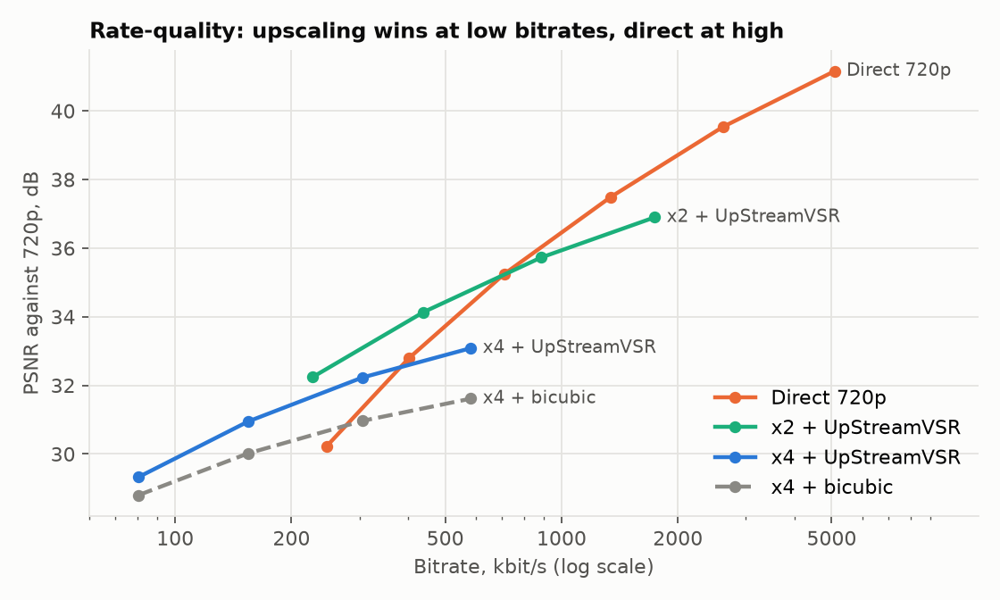
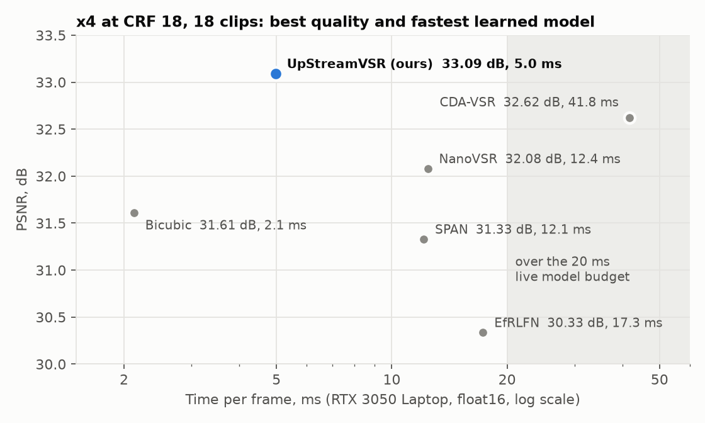
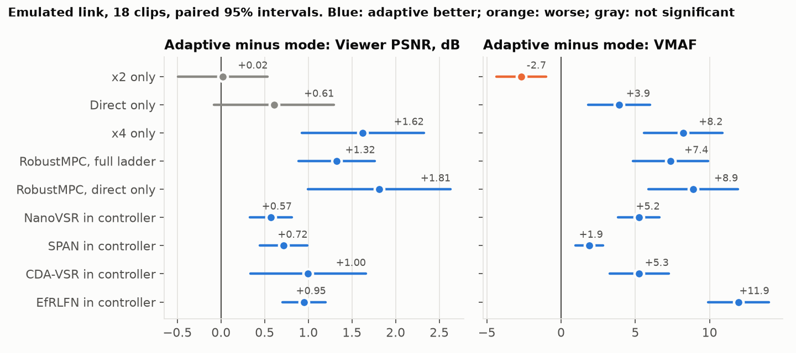
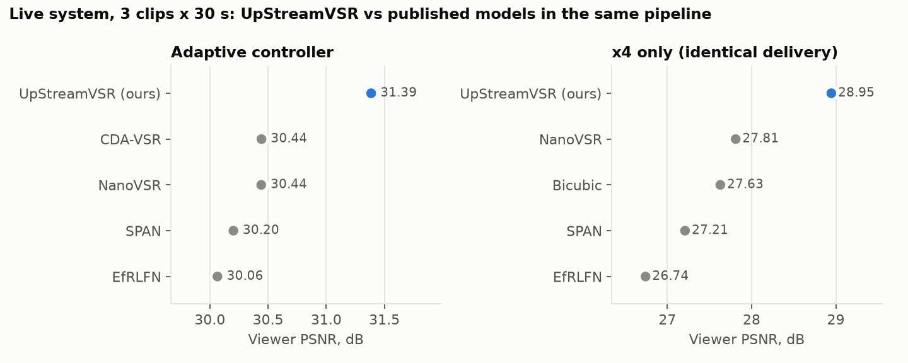
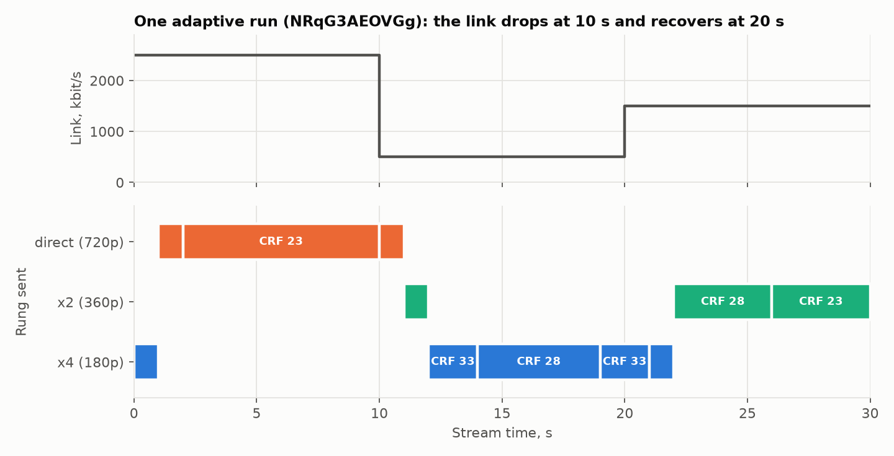

# UpStream: adaptive live video super-resolution for streaming

UpStream streams video at low resolution and upscales it on the viewer's GPU in real
time. For every frame, a controller chooses how to deliver it:

- **direct**: send 720p;
- **×2**: send 360p and upscale it;
- **×4**: send 180p and upscale it.

The controller also picks the compression level, so the stream balances four things
that pull against each other: **latency, client GPU resources, picture quality and
bandwidth**.

The upscaler is **UpStreamVSR**, a 217k-parameter super-resolution network designed
for this pipeline and trained on [StreamSR](https://github.com/EvgeneyBogatyrev/EfRLFN)
(real compressed YouTube video). Its features:

- conditioning on the encoder's compression level;
- anytime early exits, so the depth fits each frame's deadline;
- one network for ×2 and ×4.

B.Tech project. The full write-up is in [docs/REPORT.md](docs/REPORT.md).



## Results

All results are measured on an NVIDIA RTX 3050 Laptop GPU (4 GB).

| | |
|---|---|
| Against four recent published models (EfRLFN, SPAN, NanoVSR, CDA-VSR), offline, 18 clips | Best PSNR at all 8 ×2/×4 bitrates. At ×4: **33.09 dB in 5.0 ms** per frame, vs 32.62 dB in 41.8 ms for CDA-VSR, the closest. Least flicker of all. On VMAF and LPIPS, CDA-VSR and SPAN are better at ×4. |
| The same models in the live pipeline, same controller, 18 clips | **+0.57 to +1.00 dB** viewer PSNR and **+1.9 to +11.9 VMAF** (all significant at 95%), at 56–66% of their GPU power. UpStreamVSR is the only one fast enough for ×2 live. |
| Against RobustMPC, a standard ABR controller, same ladder, 18 clips | **+1.32 ± 0.44 dB** viewer PSNR, +7.4 VMAF, 33 ms lower p95 latency, half the longest freeze. |
| Adaptive vs fixed delivery, emulated link, 18 clips | Ahead of ×4-only on every metric (18/18 clips in PSNR); ahead of direct-only in VMAF (+3.9). Tied with ×2-only in PSNR but 2.7 VMAF behind it; less latency and GPU time. |
| Over real TCP (tc netem), 10 clips | With its loss-aware capacity cap, the controller is the best mode on broadband: **+1.0 dB** over ×4-only, **+1.75 dB** over RobustMPC, +1.8 dB over direct-only. On the 1%-loss mobile profile it ties ×4-only (−0.28 ± 1.07 dB), which has fewer late frames, and beats direct-only by 2.0 dB. |
| Bandwidth | For the same PSNR, ×4 + UpStreamVSR needs about 30% fewer bits than direct 720p (BD-rate −28.7%). |
| Stability | A 5-minute live run held 30 fps, with a flat 155 ms median display latency. |

"Viewer PSNR" scores every display slot against the 720p original. A late or skipped
frame counts as the previous frame held on screen, so latency problems show up as
lost quality.





## How it works

```
source ─► ffmpeg/x264, all three renditions live ─┬─ 720p  direct ─┐
          (zerolatency, keyframe every 30 frames)  ├─ 360p  x2     ─┼─► server sends the requested
                                                   └─ 180p  x4     ─┘   rung, switching on a keyframe
                                                                              │ TCP
client:  receive ─► decode (PyAV) ─► upscale on the GPU (exit per frame) ─► display on time
            ▲                                                                 │
            └──── trade-off controller: rung (rendition + CRF) from link estimate,
                  rate-quality table and GPU time budget; backlog guard ◄──────┘
```

- **Server** (`live/server.py`): encodes 13 rungs live. Direct uses CRF 23–43; ×2 and
  ×4 use CRF 18/23/28/33. The encoder settings are identical to the training data.
- **Controller** (`live/controller.py`): picks the rung with the best predicted
  quality that fits the estimated link capacity and the GPU budget (20 ms per frame).
  A backlog guard skips ahead when frames queue behind a bandwidth drop.
- **Depth policy** (`live/policy.py`): per frame, it picks the deepest model exit that
  still meets the frame's display deadline.
- **Model** (`upstream_vsr/model.py`): built from reparameterizable conv blocks that
  fuse to plain 3x3 convs, with a pixel-shuffle head. It has per-scale BatchNorm and
  CRF conditioning.
- **The model works per frame.** A recurrent memory was tried and ablated: it added no
  measurable quality, cost 65% more time and added flicker, so it was removed
  ([docs/ABLATION.md](docs/ABLATION.md)).



## Run it

Requirements:

- Python 3.12, PyTorch with CUDA, PyAV and OpenCV (for `--display`); torchvision only
  for the CDA-VSR baseline;
- FFmpeg with libx264.

The final weights are included: `runs/kaggle-7-no-state/run/best-calibrated.pt`, 0.7 MB.

```bash
pip install -r requirements-train.txt opencv-python

# terminal 1: stream a clip over an emulated link that drops from 2.5 to 0.5 Mbit/s
python live/server.py data/test-clips/NRqG3AEOVGg@1440.mp4 --crfs 18 23 28 33 \
    --direct-crfs 23 28 33 38 43 --start x4@28 --link 0:2500,10:500,20:1500

# terminal 2: receive, upscale and play, with the controller choosing the rungs
python live/client.py --checkpoint runs/kaggle-7-no-state/run/best-calibrated.pt --controller \
    --half --playout-delay 0.15 --display --compare
```

`--compare` shows bicubic on the left and UpStreamVSR on the right. The 18 test clips in
`data/test-clips/` are the `@1440` files of the StreamSR test archive
(`subjective-set.tar.gz`, linked from the EfRLFN README). Any MP4 of 720p or larger works.

Reproducing the results:

| What | Command | Write-up |
|---|---|---|
| Rate-quality table | `python scripts/measure_rate_quality.py --checkpoint <ckpt>` | [CONTROLLER.md](docs/CONTROLLER.md) |
| Live comparison of delivery modes | `python scripts/compare_modes.py <clips> --half` | [COMPARISON.md](docs/COMPARISON.md) |
| Real-network comparison | `sudo bash scripts/run_netem.sh multi` (10 clips), or without sudo through `scripts/netem_unprivileged.sh` | [COMPARISON.md](docs/COMPARISON.md) |
| Published models, offline | `python scripts/benchmark_baselines.py --half` | [BASELINES.md](docs/BASELINES.md) |
| Ablations | `python scripts/compare_modes.py <clips> --modes adaptive adaptive-bicubic ...` | [ABLATION.md](docs/ABLATION.md) |
| Training (Kaggle) | `kaggle/1_prepare_data.ipynb`, then `kaggle/2b_train_no_state.ipynb` | [MODEL.md](docs/MODEL.md) |
| Figures | `python3 scripts/plot_report.py` | |
| Tests | `python -m pytest tests` (66 tests) | |

The published models' code and weights are not redistributed. `upstream_vsr/baselines.py`
loads them from `$UPSTREAM_EXTERNAL` (default `~/Github/btp-vsr/external`).

## Repository layout

| Path | Contents |
|---|---|
| `upstream_vsr/` | model, codec and motion-vector decoding, encoder settings, training data, published-model re-implementations |
| `live/` | server, client, trade-off controller, depth policy, backlog guard, emulated link, tc-netem harness |
| `scripts/` | data preparation, training, calibration, benchmarks, comparisons, plots |
| `kaggle/` | training notebooks |
| `configs/rate_quality.json` | the controller's measured rate-quality table |
| `docs/` | report and detailed write-ups |
| `tests/` | unit tests |
| `server/`, `client/`, `presentation_assets/`, `logs/` | the October 2026 study (off-the-shelf NanoVSR over MPEG-TS), superseded |

## Limitations

- One laptop GPU.
- Emulated-link and offline comparisons use 18 clips × 30 s; the tc netem runs use 10 clips.
- On the 1%-loss mobile path, the controller only ties always sending ×4, which has fewer late frames.
- The networks are emulated, or shaped with tc netem on one machine.
- Quality is measured in PSNR, VMAF and LPIPS, with no user study. The model and the
  controller are tuned for PSNR, which costs them on the perceptual metrics.
- The published models were adapted to run causally, one frame at a time
  ([docs/BASELINES.md](docs/BASELINES.md)).

## Credits

- StreamSR dataset and EfRLFN: Bogatyrev et al.
- SPAN: Wan et al.
- NanoVSR: Pawlicki et al.
- CDA-VSR: sspBIT.

Their code and weights are used under their own licenses and are not included here.
