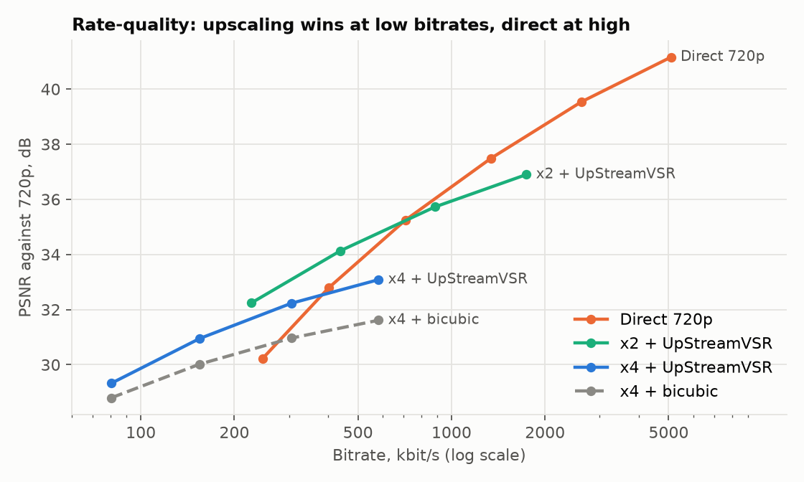
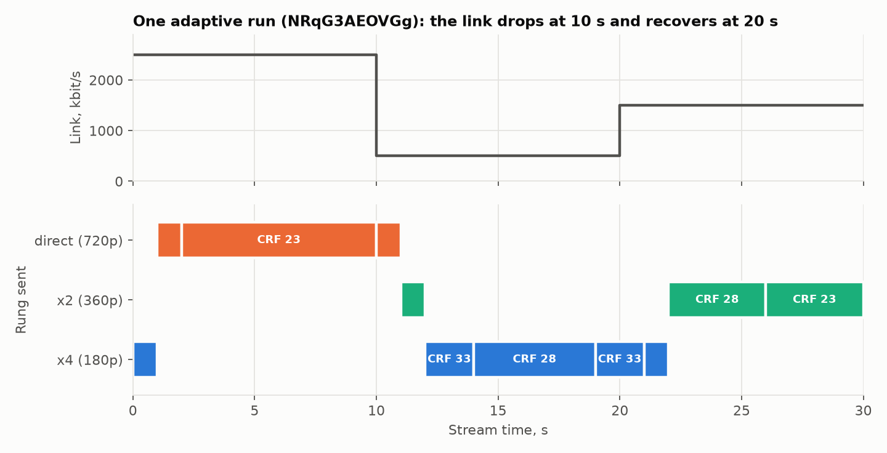
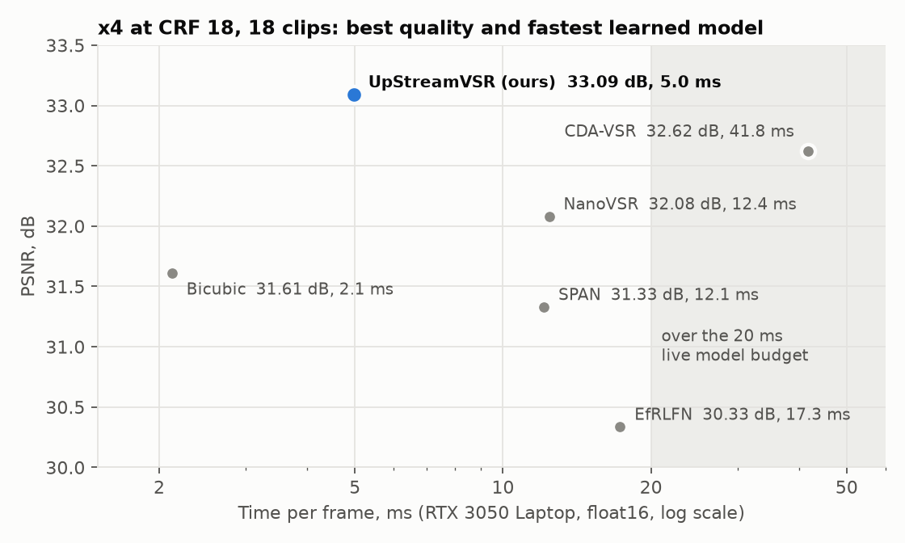
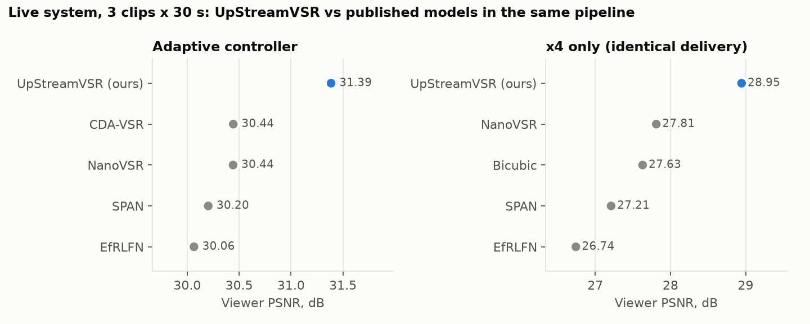
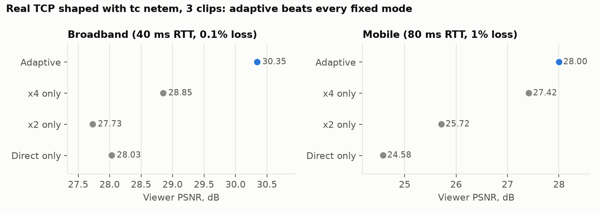

# UpStream: adaptive live video super-resolution for streaming

B.Tech project report. Code: github.com/denzel-robin/UpStream. Everything was measured
on one NVIDIA RTX 3050 Laptop GPU (4 GB); every number here can be traced to `results/`
and to the detailed write-ups in `docs/`.

## Abstract

A video stream can be sent at full resolution, or sent at a lower resolution and
upscaled on the viewer's GPU. Upscaling saves bandwidth, but it costs client GPU time,
adds latency, and only helps if the upscaled picture beats a full-resolution stream at
the same bitrate.

UpStream is a live streaming system that makes this choice for every frame. It picks
between three deliveries:

- **direct**: send 720p;
- **×2**: send 360p and upscale it;
- **×4**: send 180p and upscale it.

It also picks the compression level and how deep the upscaling network runs. These
choices balance four quantities: latency, client resources, quality and bandwidth.

The upscaler, **UpStreamVSR**, is a 217k-parameter network designed for this setting:

- it is conditioned on the encoder's compression level;
- its depth can change per frame (anytime exits);
- one network serves both scales.

It was trained on real compressed video (StreamSR).

Results:

- **Offline**, it beats four recent published models (EfRLFN, SPAN, NanoVSR, CDA-VSR) at
  every bitrate tested, and is the fastest of them: 33.09 dB in 5.0 ms at ×4, against
  32.62 dB in 41.8 ms for CDA-VSR.
- **In the live system**, it gives 0.95–1.33 dB higher viewer PSNR than the same system
  running those models, at 55–62% of their GPU power.
- **Over real TCP shaped with tc netem**, adaptive delivery beats every fixed delivery
  mode: by 1.5 dB on a broadband profile and 0.6 dB on a mobile one.
- **Ablations** show that the sender's backlog guard is the largest single contribution
  (0.83 dB, and half the late frames).
- **The recurrent memory**, borrowed from recent video super-resolution, added no
  measurable quality. It was removed, which made the model 65% faster at ×4 and steadier.

## 1. Introduction

### 1.1 The problem

Live video must reach the screen within a fixed delay, at whatever rate the network
allows at that moment. Adaptive bitrate streaming handles this by switching between
pre-encoded qualities. Super-resolution adds another option: send fewer pixels and
reconstruct the rest on the client. That option is not free.

- **Bandwidth.** At low bitrates, a 180p or 360p stream gets far more bits per pixel
  than a 720p stream at the same rate, so it carries fewer compression artifacts. At
  high bitrates, direct 720p wins, because no upscaler recovers what was never sent.
- **Resources.** The client GPU must run the network for every frame. On a laptop,
  that means power, heat, and competition with other applications.
- **Latency.** Each frame must be reconstructed before its display deadline. A model
  that is slower than the frame interval falls behind, however good its output.
- **Quality.** This is what the viewer sees. It depends on all three of the above, and
  on how often frames arrive late and the picture freezes.

So the right choice depends on the network, the content and the GPU, and all three
change while the stream plays. This project builds a system that makes the choice
continuously, and a model designed to be a good citizen of that system.

### 1.2 What the earlier study showed

An earlier phase of this project (October 2026; `presentation_assets/`,
`logs/progress-report-handoff.md`) streamed real clips over MPEG-TS and compared three
options: direct delivery, bicubic upscaling, and an off-the-shelf NanoVSR. Two findings
shaped this work:

1. **At matched bitrates, direct delivery beat NanoVSR** on quality and client cost
   (at 360p playback). An upscaler is only worth running where the rate-quality curves
   say so. That calls for a controller, not a fixed mode.
2. **NanoVSR failed a 5-minute sustained run.** It fell to 20.87 fps and stopped at
   80 s. A model that is good offline is useless live if it cannot keep up.

### 1.3 Goals

The goals were recorded in `docs/GOALS.md`:

- a live pipeline that balances latency, resources, quality and bandwidth;
- a new model trained on StreamSR, for ×2 and ×4, drawing on NanoVSR and CDA-VSR;
- the project's own techniques: a trade-off controller and anytime depth;
- evaluation under realistic network conditions, with ablations, a sustained run, and
  comparisons against published models.

### 1.4 Contributions

1. **A live streaming system** that chooses delivery (direct, ×2, ×4), compression level
   and model depth per frame. It does this from measured link capacity, measured GPU
   time and a measured rate-quality table, and adds a sender-side backlog guard.
2. **UpStreamVSR**, a 217k-parameter upscaler with:
   - compression-level conditioning;
   - anytime exits;
   - one network for ×2 and ×4;
   - training on data encoded exactly as the live stream is.
3. **A system-level evaluation.** It uses a viewer-PSNR metric that counts late frames
   as frozen, and runs over emulated and real (tc netem) networks against four
   published models.
4. **Ablations** of every part, including a negative result: recurrent memory does not
   pay on compressed live streams at this scale.

## 2. Background

- **Efficient super-resolution.**
  - SPAN (NTIRE 2024 efficient-SR winner) and EfRLFN (ICLR 2026; also the source of the
    StreamSR dataset) are single-image models built for speed.
  - NanoVSR (ECCV 2026) is a small bidirectional recurrent video model with
    reparameterizable blocks.
  - CDA-VSR (CVPR 2026) is an online video model that uses codec motion vectors,
    residuals and frame types to align a recurrent state.
- **Super-resolution in streaming systems.** NAS (OSDI 2018), NEMO (MobiCom 2020) and
  LiveNAS (SIGCOMM 2020) combine neural enhancement with adaptive streaming.
  - They differ from this project in that they use content-specific models and/or
    server-side training.
  - UpStream uses one general model and makes the delivery and depth decisions jointly
    on the client.
- **Video coding.**
  - H.264/x264 with a constant rate factor (CRF) sets quality, and the bitrate follows
    from it.
  - Keyframes (I-frames) are the only points where a decoder can join a stream, so a
    switch between renditions happens at a keyframe.
  - BD-rate (Bjøntegaard) gives the average bitrate difference between two
    rate-quality curves at equal quality.

## 3. System overview

```
source ─► ffmpeg/x264, all renditions live ──┬─ 720p  direct (CRF 23–43) ─┐
          (zerolatency, keyframe every 30)   ├─ 360p  x2 (CRF 18–33)     ─┼─► server sends one rung,
                                             └─ 180p  x4 (CRF 18–33)     ─┘   switching on a keyframe
                                                                                    │ TCP
client:  receive ─► decode (PyAV) ─► upscale on GPU (exit per frame) ─► display at deadline
            ▲                                                                      │
            └── controller: link estimate + rate-quality table + GPU budget ◄──────┘
                 (switch request);   server: backlog guard (skip to next keyframe)
```

- **Server** (`live/server.py`):
  - One FFmpeg process reads the source at its frame rate and encodes 13 **rungs** at
    once: direct at CRF 23/28/33/38/43, and ×2 and ×4 at CRF 18/23/28/33.
  - It uses the same filter graph and x264 settings as the training data: veryfast,
    zerolatency, a keyframe every 30 frames, no B-frames.
  - Frames are released on the source clock, as a camera would deliver them. Only the
    requested rung is sent.
- **Client** (`live/client.py`):
  - Receive, decode, reconstruct and display run as threads joined by small bounded
    queues.
  - Frames go on screen at a fixed playout delay (150 ms) after capture. A frame that
    misses its slot by more than 50 ms is dropped.
- **Controller** (`live/controller.py`): runs on the client and sends switch requests
  to the server.
- **Depth policy** (`live/policy.py`): chooses the model exit for each frame.
- **Backlog guard** (`live/backlog.py`): runs on the server.

## 4. The four-way trade-off

### 4.1 What each quantity is and how it is measured

| Quantity | Measured as | Measured from |
|---|---|---|
| **Latency** | Display latency (capture to screen), late and skipped frames, freezes | Server timestamps on every packet; client display times |
| **Resources** | Model GPU time per frame and as a share of wall time, GPU power, memory, CPU | CUDA-synchronised timers per scale and exit; nvidia-smi |
| **Quality** | Viewer PSNR against the 720p original (late frames count as held frames) | Recorded output scored offline; the controller predicts it from the rate-quality table |
| **Bandwidth** | Bits actually sent; link capacity | Server rate reports per rung; client capacity estimate from keyframe delay |

### 4.2 How they are balanced

**Quality is the objective; the other three are constraints.** On every packet, the
controller works in four steps:

1. **Resources: drop rungs the GPU cannot run in time.**
   - The model may use 60% of the 33 ms frame interval (20 ms). The other 40% is left
     for decoding, colour conversion and display, and for other applications.
   - An upscaled rung is allowed only if some exit's measured time fits that budget.
   - The deepest exit that fits sets the rung's predicted quality.
   - Times are running averages on the actual machine, so a busy or slow GPU
     automatically closes ×2 and ×4 and leaves direct, which needs no model.
2. **Latency: drop rungs whose keyframe could not cross the link before its display
   deadline.**
   - A keyframe is several times larger than other frames.
   - On a slow link, a large keyframe alone can break the deadline.
3. **Bandwidth: set an allowance.**
   - Normally this is 85% of the estimated capacity, or 95% for the rung already in use,
     so that an estimate near the edge does not flip rungs.
   - If a queue is building (the **drain** state), the allowance is half the capacity,
     and the server is asked to skip to the next keyframe, so the queue empties instead
     of delaying every following frame.
4. **Quality: among the rungs left, take the highest predicted PSNR.** Among rungs
   within 0.05 dB of the best, take the cheapest.

**Hysteresis.** Steps down happen at once. Steps up need a gain of at least 0.1 dB, a
short queue, and 2 s since the last step down.

**Two timescales.**

- **Slow loop: the rung.** It is decided per packet, but takes effect only at the next
  keyframe (at most 1 s). It trades bandwidth against quality, using the rate-quality
  table.
- **Fast loop: the model exit.** It is decided for each frame from the time left before
  that frame's deadline. It trades resources and latency against quality, within the
  rung already chosen.

**Server-side backlog guard.**

- The client learns of congestion only when delayed packets arrive, so its signal is
  stuck in the same queue. In an early run, a scene change raised the rate fivefold,
  and 9 s of video was queued before the client could react.
- The server sees its own send queue at once. If the backlog would take longer to drain
  than the client can wait, and it is growing, the server drops frames up to the next
  keyframe. The screen holds the last frame, and pictures are never corrupted.

**Operating points.** The trade-off can be moved with three settings:

- **GPU share (default 0.6):** lower leaves more GPU for other work, at the cost of
  quality.
- **Playout delay (default 150 ms):** longer tolerates bigger keyframes and jitter, at
  the cost of latency.
- **The ladder itself:** which rungs exist.

### 4.3 How the link is estimated

- **Capacity from keyframes.** A packet entering an idle link arrives after
  `fixed + size / capacity`. Keyframes are large, so a line through recent
  (size, delay) pairs gives the capacity from its slope. Every keyframe is a free
  probe, and no extra traffic is sent.
- **Under congestion,** packets queue back to back, and the bytes divided by the
  arrival gaps give the capacity (packet dispersion).
- **Expiry.** An estimate expires after 3 s, so a capacity measured before a change in
  the link is not trusted for long.
- **Queuing delay** is split into the part a recent keyframe explains (harmless, it
  clears by itself) and the excess, which means the link has slowed.

### 4.4 Why anytime depth and equal-cost scales matter

- **Anytime depth.** A network with several exits can trade quality for time per frame
  with no reload.
  - When a frame arrives late, a shallower exit still delivers it on time.
  - The cheapest exit keeps 84% (×4) to 94% (×2) of the deepest exit's gain over
    bicubic, so the fallback costs little.
- **Similar cost at ×2 and ×4.** Both inputs map onto one feature grid at a quarter of
  the output size, so the per-frame cost is similar (4.6 ms at ×2, 5.0 ms at ×4).
  Switching scale therefore does not change whether the model fits the budget, and the
  controller can choose between ×2 and ×4 on bandwidth alone.

## 5. Switching between direct, ×2 and ×4

### 5.1 Why switch: the rate-quality crossover

At a given bitrate, fewer pixels get more bits each. Measured on 18 clips (final model,
deepest exit; `configs/rate_quality.json`):



| Rung | kbit/s | PSNR, dB | | Rung | kbit/s | PSNR, dB |
|---|---:|---:|---|---|---:|---:|
| direct@23 | 2614 | 39.53 | | x2@18 | 1743 | 36.90 |
| direct@28 | 1340 | 37.49 | | x2@23 | 884 | 35.72 |
| direct@33 | 710 | 35.24 | | x2@28 | 439 | 34.14 |
| direct@38 | 402 | 32.78 | | x2@33 | 227 | 32.24 |
| direct@43 | 246 | 30.22 | | x4@18 | 582 | 33.08 |
| | | | | x4@23 | 305 | 32.23 |
| | | | | x4@28 | 155 | 30.95 |
| | | | | x4@33 | 80 | 29.32 |

- **Below about 0.7–1 Mbit/s, an upscaled rung wins at every rate.**
  - x2@33 gives 32.24 dB at 227 kbit/s, against direct@43's 30.22 dB at 246.
  - x2@28 gives 34.14 dB at 439, against direct@38's 32.78 dB at 402.
  - Only ×4 goes as low as 80 kbit/s.
- **Above about 1 Mbit/s, direct wins.** direct@28 (37.49 dB at 1340) beats x2@18
  (36.90 dB at 1743). An upscaled stream is capped by what 360p or 180p can hold.
- **BD-rate against direct.** At equal quality, ×4 with UpStreamVSR needs 28.7% fewer
  bits (mean curves; −32.3% per clip). ×2 needs 9.2% fewer. With bicubic, both need
  *more* bits than direct (×4 +7.6%, ×2 +9.7%). **The model is what makes ×2 and ×4 worth
  sending.**
- **Content matters.** Per clip, ×2's BD-rate ranges from about −77% to +106%, so the
  controller prices rungs on the live content's actual bitrate (reported by the server
  each second), not on the table's averages.

### 5.2 When each rendition is chosen

- **×4** when bandwidth is tight. 180p costs least, and the model recovers the most per
  bit at ×4.
- **×2** in the middle range, once there is room for 360p at a decent CRF.
- **Direct** in three cases:
  - bandwidth is plentiful;
  - the GPU is too busy or slow for any exit to fit the budget (no model needed);
  - the client has no model at all.
- **CRF within a rendition** is chosen the same way: the best predicted quality that
  fits the allowance.

### 5.3 How a switch happens

- Every rung has a keyframe at the same frames (every 30). A switch request takes effect
  at the next one, so the client always gets a decodable picture.
- In the drain state, the server skips the rest of the group of pictures. The switch
  then lands on a clean keyframe with an empty queue.
- **The model keeps no state between frames,** so a switch between ×2 and ×4, or to
  direct and back, costs nothing on the client. (The earlier models kept a recurrent
  state on a shared grid so that it would survive a switch. The ablation in §7.4
  removed the need for it.)

### 5.4 An example



One clip on the emulated link (2500 kbit/s, then 500 from 10 s, then 1500 from 20 s):

1. The controller starts on ×4 and moves to direct@23 while 2.5 Mbit/s is available.
2. When the link drops, it drains and steps to ×2, then ×4 at CRF 28–33.
3. When the link recovers to 1.5 Mbit/s, it climbs back through ×4 to ×2.

## 6. UpStreamVSR

### 6.1 Design

- **Input mapping.** The ×4 input (180p) is used directly. The ×2 input (360p) is
  pixel-unshuffled by 2. Both reach one 32-channel feature grid at a quarter of the
  output size.
- **Per-scale layers.** Each scale has its own entry convolution and its own BatchNorm
  statistics, because ×2 and ×4 features differ.
- **Compression conditioning.** The stream's CRF, which the server knows, scales and
  shifts the entry features, so the model knows how much compression damage to undo.
- **Backbone.** 9 reparameterizable blocks. In training each is a 3×3 + 1×1 + identity
  branch; for inference each fuses into one plain 3×3 convolution. This is from
  NanoVSR.
- **Exits.** Three exits, after blocks 3, 6 and 9. Each has a pixel-shuffle head that
  outputs a residual on top of bilinear upscaling. The heads start at zero, so an
  untrained model is exactly bilinear.
- **Size and cost.** 217,107 parameters. The final model takes 4.6 ms at ×2 and 5.0 ms
  at ×4 (deepest exit, float16), with 69 MiB peak memory.

### 6.2 Training data

- **Source.** StreamSR's 1440p clips (real YouTube H.264).
- **Target.** Each clip is downscaled to 720p.
- **Inputs.** Each clip is re-encoded to 360p and 180p with **the live pipeline's exact
  filter graph and x264 settings**, at a random CRF from 18/23/28/33. The model
  therefore trains on precisely the artifacts it meets live.
- **Split.** 1,940 training windows, 207 for validation and 64 for testing, each 12
  frames.
- **Colour bug.** Kaggle's older FFmpeg assumed the BT.601 colour matrix on the second
  scaling step, which shifted colours in the inputs but not the targets. It was found,
  fixed, and the data rebuilt; results from before the fix were discarded.

### 6.3 Training

- **Loss:**
  - Charbonnier;
  - plus 0.1 × Charbonnier on Sobel edges;
  - averaged over all three exits, so every exit is trained;
  - plus 0.05 × a flicker loss on frame-to-frame changes.
- **Optimiser and data:** Adam at 3e-4, batch 8 windows of 12 frames, mixed precision.
  Scale switches occur mid-window with probability 0.3.
- **Hardware and length:** Kaggle T4 GPUs, 70,000 iterations, 7.6 h.
- **After training:** BatchNorm statistics were recalibrated per scale.

### 6.4 Design history

1. **First design (119k parameters).** Recurrent hidden state at both scales, warped
   with codec motion vectors and added to the features. Its fusion gate learned to
   close, and depth gave little.
2. **Second design.** The previous output frame was fused with the state, the gate
   started open, every exit was supervised, and BatchNorm became per scale.
3. **Third design.** Added motion-vector refinement, memory at ×4 only, CRF
   conditioning and the flicker loss.
4. **Final model.** The third design trained **without recurrent state** (§7.4).

### 6.5 Test-set accuracy (64 windows)

| | Bicubic | Exit 1 | Exit 2 | Exit 3 | Gain |
|---|---:|---:|---:|---:|---:|
| ×2 PSNR, dB | 31.86 | 32.62 | 32.66 | 32.67 | +0.81 |
| ×4 PSNR, dB | 27.98 | 28.92 | 29.07 | 29.10 | +1.12 |

## 7. Evaluation

### 7.1 Method

- **Viewer PSNR.** Each 1/30 s display slot is scored against the 720p original. A late
  or skipped frame counts as the previous frame held on screen. This makes latency
  visible as lost quality, which plain PSNR on decoded frames hides.
- **Emulated link.** The rate schedule is 2500 kbit/s, then 500 from 10 s, then 1500
  from 20 s. Three test clips, 30 s each, 150 ms playout delay, float16.
- **Real network.** Real TCP is shaped with Linux tc netem in a network namespace, with
  two profiles:
  - broadband: 20 ms one-way delay, 5 ms jitter, 0.1% loss;
  - mobile: 40 ms one-way delay, 15 ms jitter, 1% loss.
- **Published models.** The four models were re-implemented, loaded with their authors'
  weights, checked against the authors' code, and run causally (one frame at a time).
  - NanoVSR's backward branch sees only the current frame.
  - CDA-VSR uses the motion-compensation error in place of decoder residuals.
  - Details are in `docs/BASELINES.md`.

### 7.2 Against published models

**Offline** (18 clips, every rung; PSNR dB · ms per frame):



| Rung | **UpStreamVSR** | Bicubic | EfRLFN | SPAN | NanoVSR | CDA-VSR |
|---|---:|---:|---:|---:|---:|---:|
| x2@18 | **36.90** · 4.6 | 35.67 · 2.2 | 34.55 · 63.6 | 35.23 · 44.3 | | |
| x2@33 | **32.25** | 31.76 | 31.13 | 31.29 | | |
| x4@18 | **33.09** · 5.0 | 31.61 · 2.1 | 30.33 · 17.3 | 31.33 · 12.1 | 32.08 · 12.4 | 32.62 · 41.8 |
| x4@33 | **29.34** | 28.80 | 28.06 | 28.34 | 28.80 | 29.18 |

- **Quality:** UpStreamVSR is best at all eight rungs, ahead of CDA-VSR by 0.2–0.5 dB.
- **Flicker:** it is the steadiest at every rung, tied with EfRLFN at x4@33.
- **×2 live:** it is the only model fast enough. EfRLFN (64 ms) and SPAN (44 ms) run at
  full 360p resolution.

**Live, same controller** (3 clips; viewer PSNR):



| | Adaptive | GPU W | ×4 only | GPU W |
|---|---:|---:|---:|---:|
| **UpStreamVSR** | **31.39** | 20.5 | **28.95** | 22.2 |
| NanoVSR | 30.44 | 32.9 | 27.81 | 52.2 |
| CDA-VSR | 30.44 | 17.2 | 14.06* | 68.4 |
| SPAN | 30.20 | 35.3 | 27.21 | 56.0 |
| EfRLFN | 30.06 | 37.4 | 26.74 | 58.1 |
| Bicubic | | | 27.63 | 19.6 |

\*CDA-VSR forced onto ×4: only 153 of 2,700 frames reached the screen on time.

- **Adaptive:** UpStreamVSR gains 0.95–1.33 dB, at 55–62% of the others' GPU power.
  - Most of the gain comes from ×2, which carries about half of its frames. The others
    cannot run ×2 in time and fall back to direct, which needs more bandwidth for the
    same quality.
  - CDA-VSR is too slow for ×4 (42 ms against a 20 ms budget), so the controller keeps
    it on direct 94% of the time. CDA-VSR's power is low only because it barely runs.
- **×4 only, where delivery is identical:** UpStreamVSR leads by 1.1–2.2 dB, at under
  half the GPU time.

### 7.3 Adaptive vs fixed delivery

Emulated link (3 clips):

| Mode | Viewer PSNR, dB | Shown / late / skipped | Model GPU % | kbit/s |
|---|---:|---:|---:|---:|
| direct only | 30.75 | 2391 / 71 / 238 | 0.0 | 582 |
| ×2 only | 31.84 | 2497 / 49 / 154 | 18.4 | 611 |
| ×4 only | 28.95 | 2610 / 22 / 68 | 19.6 | 392 |
| **adaptive** | 31.49 | 2474 / 59 / 167 | 13.9 | 643 |

- On this simple emulated link, which has no propagation delay or loss, ×2 only scores
  slightly higher than adaptive: 31.84 vs 31.49 dB (31.75 vs 31.64 with the earlier
  model). The controller's caution costs a little here. It keeps headroom below the
  capacity estimate, and it moves to direct when the link allows.
- The real network reverses this: ×2 only is the worst mode on broadband and the second-worst on mobile.

Real TCP with tc netem (3 clips):



| Profile | Direct | ×2 | ×4 | **Adaptive** |
|---|---:|---:|---:|---:|
| Broadband (40 ms RTT, 0.1% loss) | 28.03 | 27.73 | 28.85 | **30.35** |
| Mobile (80 ms RTT, 1% loss) | 24.58 | 25.72 | 27.42 | **28.00** |

- **Adaptive is best on both profiles:** +1.5 dB on broadband and +0.6 dB on mobile.
- **Why real TCP hurts fixed modes:** a lost packet stalls everything behind it, so
  rates that fit on an emulated link overflow the deadline. Only the controller backs
  off.
- **Per clip,** adaptive is best in 3 of 6 runs and within 0.3 dB in 2 more. It loses
  clearly once, to ×4 only, on one clip over mobile.
- **Noise:** real-network runs vary by 0.3–1.5 dB from run to run, even for direct,
  which uses no model.

### 7.4 Ablations

Each row removes one part. Idle-GPU rows run on an idle GPU; loaded rows run with
another process holding the GPU at 98% utilisation.

| Variant | Viewer PSNR, dB | Late frames | p95 latency |
|---|---:|---:|---:|
| **Adaptive, idle GPU** | **31.44** | 69 | 169 ms |
| Bicubic in place of the model | 30.68 (−0.76) | 72 | 167 ms |
| No backlog guard | 30.61 (−0.83) | 133 | 324 ms |
| **Adaptive, loaded GPU** | **31.41** | 79 | 177 ms |
| Fixed depth (deepest exit) | 31.38 (−0.03) | 84 | 181 ms |
| No GPU awareness | 31.41 (0.00) | 78 | 177 ms |

- **The model** adds 0.76 dB overall, with identical delivery. That is about 1.1 dB on
  each upscaled frame, for 8 points of GPU time and 3 W.
- **The backlog guard is the largest single part.** Without it, late frames and p95
  latency double. Frames queued behind a bandwidth drop arrive too late to show.
- **Anytime exits and GPU awareness** have little measurable effect on this GPU, because
  even the deepest exit (5 ms) fits the budget under load.
  - With the earlier, slower model, anytime exits saved 19 late frames (+0.11 dB).
  - GPU awareness steps in on hardware too slow for the model; a unit test covers it.
- **Recurrent state.** The third design was retrained with the state cleared before
  every frame, with everything else the same. On 18 clips:

| | With state | Without (final) |
|---|---:|---:|
| ×4 PSNR, CRF 18 / 33 | 33.11 / 29.39 | 33.09 / 29.34 |
| ×4 temporal PSNR (steadiness), CRF 18 / 33 | 38.69 / 34.76 | **38.83 / 35.58** |
| ×4 time per frame | 8.2 ms | **5.0 ms** |
| Peak memory (live) | 94 MiB | **69 MiB** |

  - The state added 0.02–0.05 dB at ×4. That is below the 0.03–0.06 dB difference
    between two training runs, measured at ×2, where neither model uses state.
  - The state cost 65% more time and made the output flicker more than bicubic at low
    bitrates.
  - It was removed. In the live system, quality stayed the same within run-to-run noise.

### 7.5 Stability and resources

- **5-minute live run** (9,000 frames, link changing every 30 s between 400 and
  3000 kbit/s):
  - 30 fps throughout;
  - display latency 155 ms median, 160 ms p95 (adaptive);
  - model 6.6 ms per frame on average;
  - peak model memory 69 MiB;
  - GPU at most 63 °C;
  - renditions used: ×2 54%, direct 20%, ×4 22%, skipped 4%.
- **18-minute continuous run of the earlier model with state** (32,400 frames, state
  never reset): no drift. The same clips scored within 0.03 dB after 9 minutes, and the
  state stayed bounded. The final model has no state to drift.
- **Typical cost in the adaptive mode:**
  - model GPU time 14% of wall time;
  - about 21 W GPU power, against 13 W for direct-only delivery;
  - about 55% of one CPU core.

## 8. Discussion

- **The system matters more than the model's offline score.** CDA-VSR is within
  0.5 dB of UpStreamVSR offline, but in the live system it is 1 dB behind, because it
  cannot meet the frame deadline. Speed is a quality metric when frames have deadlines.
- **Measured negative results changed the design.**
  - Recurrent memory is the defining idea of video super-resolution, but on compressed
    180p/360p inputs with one-second GOPs, it did not pay at this model size.
  - GPU awareness and anytime depth are safeguards whose value shows only on weaker
    hardware.
- **The bandwidth case for upscaling is real but bounded.** Below about 1 Mbit/s,
  sending fewer pixels and upscaling wins; above that, direct wins. The controller's job
  is to know which side of the crossover it is on, frame by frame.

## 9. Limitations

- **Hardware and scale:** one laptop GPU; live comparisons use 3 clips × 30 s, offline
  ones 18 clips; networks are emulated or shaped on one machine.
- **Metrics:** PSNR only, with no VMAF, LPIPS or user study. PSNR may undersell EfRLFN,
  whose authors rank by subjective quality, and SPAN, trained on clean images.
- **Baselines:** the published models were adapted to run causally and were not
  fine-tuned on StreamSR.
- **Output resolution:** 720p only.

## 10. Future work

- Perceptual metrics (VMAF, LPIPS) and a small user study.
- More clips, with confidence intervals.
- A weaker GPU, where anytime depth and GPU awareness should matter.
- A standard ABR algorithm (for example MPC) over the same ladder, as a controller
  baseline.
- Fine-tuning the published models on StreamSR, for a stricter comparison.
- 1080p output.
- Keyframe-aware rung pricing.

## 11. Conclusion

UpStream shows that client-side super-resolution can be a practical part of live
streaming:

- **When it is chosen per frame,** against measured bandwidth, latency and GPU limits,
  rather than always on.
- **When the model is built for the deadline** rather than for an offline benchmark.

The 217k-parameter UpStreamVSR beats four recent published models at every bitrate
tested, while running fast enough to make ×2 and ×4 delivery usable live. Inside the
adaptive system, it gives about 1 dB higher viewer quality than those models, at roughly
half their GPU power.

## References

- E. Bogatyrev et al., EfRLFN and the StreamSR dataset, ICLR 2026.
  github.com/EvgeneyBogatyrev/EfRLFN
- C. Wan, H. Yu et al., SPAN: Swift Parameter-free Attention Network, CVPR Workshops
  (NTIRE) 2024. github.com/hongyuanyu/SPAN
- F. Pawlicki et al., NanoVSR, ECCV 2026. github.com/filippawlicki/nanovsr
- CDA-VSR, CVPR 2026. github.com/sspBIT/CDA-VSR
- H. Yeo et al., Neural Adaptive Content-aware Internet Video Delivery (NAS), OSDI 2018.
- H. Yeo et al., NEMO: Enabling Neural-enhanced Video Streaming on Commodity Mobile
  Devices, MobiCom 2020.
- J. Kim et al., Neural-Enhanced Live Streaming: Improving Live Video Ingest via Online
  Learning (LiveNAS), SIGCOMM 2020.
- G. Bjøntegaard, Calculation of average PSNR differences between RD-curves, VCEG-M33,
  2001.

## Reproducing

Commands for every table are in the README and in each `docs/*.md` file. Raw results
are in `results/` (local), and the figures come from `scripts/plot_report.py`.
